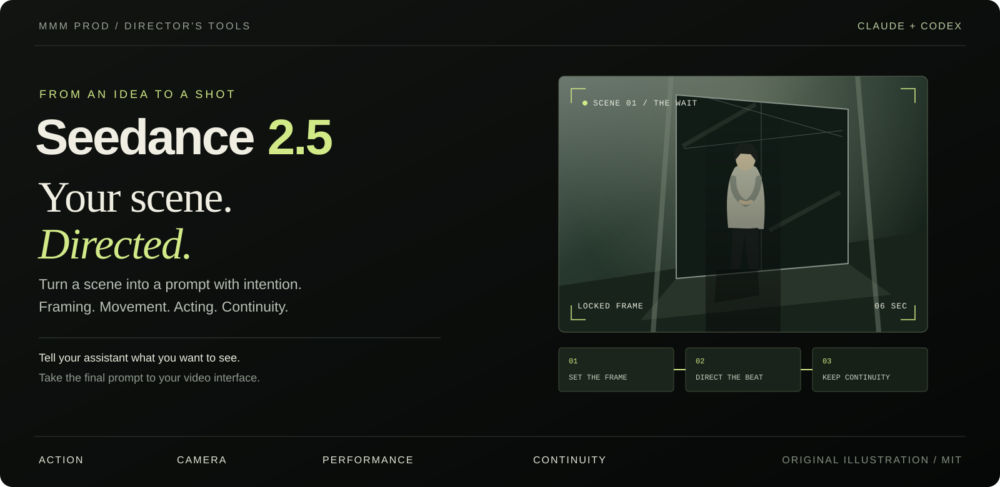

<p align="center">
  
</p>

<h1 align="center">Skill Seedance 2.5</h1>

<p align="center">
  <strong>Votre idée. Un prompt clair. Une scène avec une intention.</strong><br>
  Un skill de mise en scène et d’écriture de prompts, pour Claude et Codex.
</p>

<p align="center">
  <a href="https://raw.githubusercontent.com/MMMProd-Org/seedance-2-5/refs/heads/main/downloads/seedance-2-5.zip"><strong>Télécharger le ZIP</strong></a>
  &nbsp; · &nbsp;
  <a href="https://raw.githubusercontent.com/MMMProd-Org/seedance-2-5/refs/heads/main/downloads/seedance-2-5.skill">Télécharger le .skill</a>
  &nbsp; · &nbsp;
  <a href="#installer-en-quelques-étapes">Installer</a>
  &nbsp; · &nbsp;
  <a href="README.md">English</a>
  &nbsp; · &nbsp;
  <a href="LICENSE">MIT</a>
</p>

---

Vous avez une scène en tête : une personne qui attend, une caméra qui suit une
voiture, un geste qui se poursuit au plan suivant. Ce skill aide votre assistant
à en faire un prompt avec une action visible, des choix de caméra précis et des
états cohérents.

Il aide aussi à parler d’un résultat décevant : ce que vous attendiez, ce qui
apparaît et quelle consigne compte. Ces preuves servent à choisir la prochaine
correction.

**Assistant recommandé : Claude.** L’auteur rapporte ses meilleurs résultats
avec Claude. Les mêmes fichiers s’installent dans Codex. Ce dépôt ne contient
pas de comparaison contrôlée entre les deux assistants.

## Ce qu’il vous aide à diriger

| Votre scène demande… | Les fiches du skill couvrent… |
| --- | --- |
| Un plan lisible | Cadre, placement, optique, mouvement de caméra et lumière |
| Un personnage présent | Tâche de jeu, écoute, dialogue et silence dirigé |
| Une action compréhensible | Contacts, mouvement, cause et conséquence, duels et mécanismes |
| Plusieurs plans raccordés | Temps de l’action, coupes, états des objets et continuité |
| Des références bien utilisées | Personnage, lieu, look, voix et ancrage par l’image |
| Un diagnostic utile | Consigne absente, contradictoire ou ignorée, avec ses preuves |

Le skill rédige du texte à coller dans votre interface vidéo. Vous y générez la
vidéo, puis vous pouvez rapporter le résultat pour l’examiner avec l’assistant.

## Installer en quelques étapes

### Claude web ou Desktop — pour démarrer facilement

1. [Téléchargez le ZIP](https://raw.githubusercontent.com/MMMProd-Org/seedance-2-5/refs/heads/main/downloads/seedance-2-5.zip). Gardez-le compressé.
2. Dans Claude, ouvrez **Customize → Skills → + Create skill → Upload a skill**.
3. Importez le ZIP, activez le skill et démarrez une conversation sur votre scène.

Si Skills n’apparaît pas, vérifiez l’activation de l’exécution de code ou les
réglages de votre organisation. [Guide officiel d’installation](https://support.claude.com/en/articles/12512180-use-skills-in-claude).

### Claude Code

Téléchargez et décompressez le ZIP. Placez le dossier `seedance-2-5` entier dans
votre dossier personnel de skills :

| Système | Dossier à créer |
| --- | --- |
| Linux, macOS ou WSL | `~/.claude/skills/seedance-2-5/` |
| Windows natif | `%USERPROFILE%\.claude\skills\seedance-2-5\` |

`SKILL.md`, `references/`, `assets/`, `agents/` et `LICENSE` restent ensemble.
Ouvrez Claude Code et appelez le skill :

```text
/seedance-2-5 Écris une scène de 6 secondes où une femme attend devant une entrée vitrée.
```

[Guide officiel des skills Claude Code](https://code.claude.com/docs/en/skills).

### Codex

Téléchargez et décompressez le même ZIP. Placez le dossier `seedance-2-5` entier
dans votre dossier personnel de skills :

| Système | Dossier à créer |
| --- | --- |
| Linux, macOS ou WSL | `~/.agents/skills/seedance-2-5/` |
| Windows natif | `%USERPROFILE%\.agents\skills\seedance-2-5\` |

Ouvrez Codex et sélectionnez le skill avec `/skills`, ou appelez-le directement :

```text
$seedance-2-5 Écris une scène de 6 secondes où une femme attend devant une entrée vitrée.
```

Redémarrez Codex si le nouveau skill n’apparaît pas.
[Guide officiel des skills Codex](https://learn.chatgpt.com/docs/build-skills).

**Vous utilisez WSL ?** Installez dans le dossier personnel Linux lorsque votre
assistant tourne dans WSL. **Vous faites une mise à jour ?** Conservez votre
dossier de skill actuel avant de le remplacer.

Le téléchargement `.skill` contient les mêmes données ZIP. Pour le parcours
d’import documenté par Claude, utilisez le fichier qui se termine par `.zip`.

## Essayez avec votre scène

**Un moment calme, sans référence nécessaire**

```text
Utilise Seedance 2.5. Écris un prompt vidéo de 6 secondes en 9:16.
Une femme attend devant une entrée vitrée fermée. Plan moyen fixe, sans coupe.
Ses mains restent ensemble. Elle relâche un souffle ; personne n’arrive.
Rédige le prompt en anglais.
```

**Une séquence avec vos propres images importées**

```text
Utilise Seedance 2.5 avec les deux images que j’ai importées.
La première définit le personnage ; la seconde définit le lieu.
Écris deux plans raccordés : elle entre dans la pièce et pose un sac.
Conserve son identité, le sac et les positions finales des objets.
```

**Un résultat que vous voulez comprendre**

```text
Utilise Seedance 2.5 pour diagnostiquer ce résultat.
J’ai demandé un plan large fixe ; la vidéo se rapproche et coupe les pieds.
Voici le prompt : [collez-le ici].
Explique ce que le texte permet d’établir et quelles preuves te manquent.
```

Indiquez votre durée, le format de l’image, l’action et vos références. Vous
pouvez parler dans votre langue et choisir celle du prompt final. À défaut de
langue demandée ou de prompt existant qui la fixe, le prompt est rédigé en anglais.

## Ce que vous recevez

Le format complet du skill prévoit une durée, un contrôle du texte, un seul
prompt final et une courte liste de symptômes visibles à surveiller. Un bloc de
préparation d’image apparaît lorsque l’approche retenue demande une image de départ.

Vous voulez uniquement le prompt ? Dites **« Seulement le prompt final, sans
explication. »** Les instructions du skill gardent alors ses contrôles internes.

Deux cas complets de prompts sont également disponibles dans
[le dossier d’exemples](skills/seedance-2-5/assets/cases/). Ce sont des textes ;
ce dépôt ne contient ni clips générés ni images de référence pour ces cas.

## Dans le téléchargement

```text
seedance-2-5/
├── SKILL.md             Instructions centrales et parcours de lecture
├── references/          23 fiches ciblées
├── agents/openai.yaml   Métadonnées de présentation pour Codex
├── assets/              Icône et deux cas textuels
└── LICENSE              Licence MIT
```

Les fiches couvrent l’écriture du plan, le jeu, la physique, les références,
les séquences, le diagnostic, la syntaxe, les contraintes et la livraison.
Le skill demande à l’assistant d’ouvrir les fiches utiles à la scène courante.

**2.5 désigne le modèle ciblé par le skill.** Ce n’est pas un numéro de version
de ce dépôt. Les capacités vidéo et les réglages dépendent de votre interface.
Le contrôle de l’assistant porte sur le texte ; il reste nécessaire de regarder
la vidéo générée. L’import dans chaque assistant et la qualité vidéo n’ont pas
été testés pendant cette préparation. Consultez le [rapport de vérification](docs/verification.md).

## Pour maintenir le skill

Les sources modifiables sont dans [skills/seedance-2-5/](skills/seedance-2-5/).
Les deux téléchargements sont fabriqués avec la bibliothèque standard de Python.
Pour les refaire et les vérifier :

```sh
python3 -B scripts/package_skill.py
python3 -B -m unittest discover -s tests -v
python3 -B scripts/package_skill.py --check
```

Les contrôles couvrent les liens locaux, les métadonnées nécessaires, la licence,
les chemins sûrs et l’identité entre sources et archives. Les tests utilisent
des dossiers temporaires. La CI lance les mêmes tests et la vérification du
paquet en lecture seule. Les règles de travail partagées sont dans
[AGENTS.md](AGENTS.md), avec un renvoi depuis [CLAUDE.md](CLAUDE.md).

Un cas à améliorer ? [Ouvrez une issue](https://github.com/MMMProd-Org/seedance-2-5/issues)
avec votre demande, le prompt et le résultat observé.

Distribué sous [licence MIT](LICENSE). Présentation du README inspirée de
[Ponytail](https://github.com/DietrichGebert/ponytail), avec une illustration originale.
